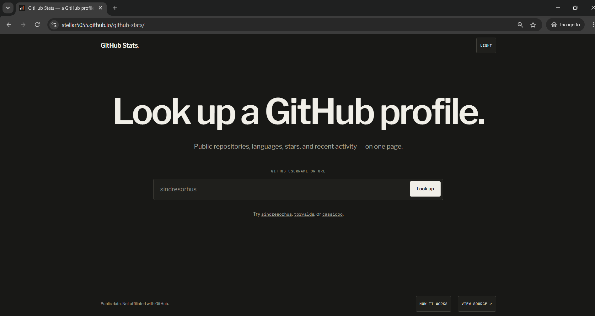
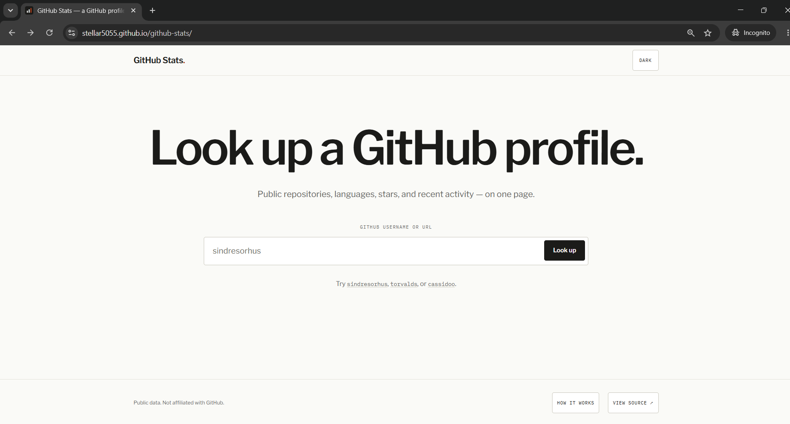
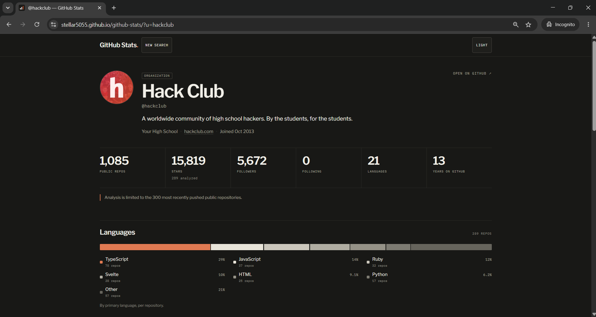
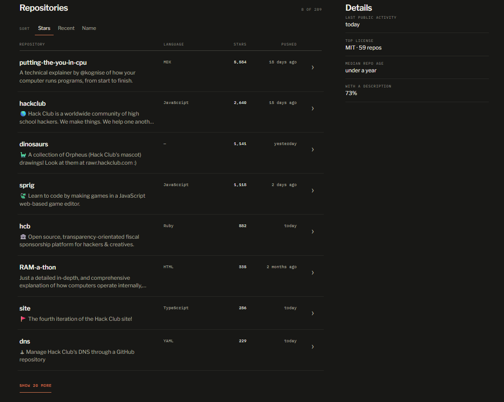
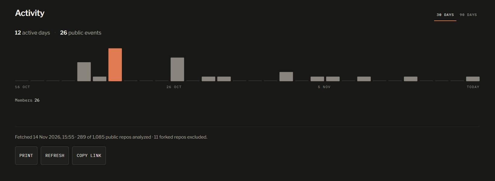

# MY Build JOURNAL

**Notes-** All like times mentioned are in IST.I tought about writing this after finishing it, so the times may not be fully correct but the details are correct. All the From To times are not of continuse coding, there might have been small breaks in between

## DAY 1 - 12/11/26

- Today I was planning - got the idea in my head in the evening (around 5PM), wrote a baisic spec (for my and my AI agent's reference) 

- The base plan was : _A small, printable GitHub profile stats page — enter a handle or profile/repo URL, get one page with stats, languages, repositories, and recent activity._

- Didnt make the repo and didnt code anything today

## DAY 2 - 13/11/26

- At early morning (around 6 a.m.), I created the project folder, made all the base files that I had planned for, then used an AI agent (through opencode) to make the baisic code for the actual working. The UI was very bad and sloppy, so i didnt commit yet, but this time was tracked. Then i did some manual coding, and some small changes with the AI agent. Worked until 8 a.m. almost, then went to school

- Came back from school (half day) at 1 p.m. and continued working. now, i spent a while manually making the UI because the ai made one was sloppy. after that, i made the github repository and made first commit of this much at around 2 p.m. then deployed to github pages then again I spend a long time with the agents refining the code wich was mostly - improved speed, added like a method page as docs (manual), added a cache system to prevent users from having to rescan if you accidentally refresh, and some tinu ui refinements. I also added a few CI workflows in github. this went on till around 5:30 p.m. 

- Then i took a break and continued at around 6:00 p.m. most important thing here was, i tried to add a contribution graph, made it but my agent said it wont work with github pages because it would require a backend, so decided to remove that because i didnt want to switch to render free now, and my hackclub nest was still under review at that time. I also improved what all the results pages showed, and also added repository details viewing also if you click them in a user profile. Then i made dark and light themes and a small switcher on the top. Then revamped the ui manually again - because mainly the agent left a lot of "Not Affiliated With Github" everywhere and also i didnt realy like the look of the buttons. then i asked the agent to make the themes persistant with localstorage and also auto apply theme if browser has theme preference. this part i didnt really understand how it worked, i decided to look into it soon. stopped at around 9 p.m.

- Continued after 10 p.m. I decided to spend a little time designing assets  first i made an og image and then for favicon, i realized that the placeholder that the agent had made in svg was alright, so decided to keep it. now, the main homepage ui had some free space towards the right so i asked the agent to make some animation/interactive stuff there. it made like a sample report, i didnt like it very much, tought i would redisign it manually the next day. i spent around 20 more minutes learning more about how everything in the app works, i knew most of it, just had to learn the localstorage part mainly since i havent done that before.

## DAY 3 - 14/11/26

- Today was a Saturday, so more time. Morning I woke up at 6 a.m. and decided to learn how the browser theme preference thing worked because i havent even heard of that before. After that, at around 7 a.m. I tried to manually improve the homepage right side thing, but whatever I tried, it just looked out of place, so i decided to remove it. then i asked the agent to try making another thing to fill that space. it made this thing called Moiré field, i havent heard of that before, so i watched some youtube videos about while the agent implemented that, after it finished and I tried the website, it still felt out of place - like it made a box with the patterns (circular) inside it. so i did some manual coding - where i firstly removed the box, then expanded it to streach across the full screen verticaly, and made it split so only arcs. (sorry if this doesnt make sense, i dont know how to explain it) it still looked not very good, i even added a small fade in on the left side, still looked bad. then I decided to remove it. I asked the agent for some other ideas, and i would implement them, none of them seemed good. so i just decided to drop that interactive idea and just rearrange the ui components on my own to fill the gap on the right. this took a while, and after that it was around 12:30 p.m. then i improved spacing in the ui a little manually and then asked the ai agent, is there any immediate like improvement oppurtunities, it told some, i asked it to implement them while i learned about them - mostly twitter metadata and og image linking, then i manually worked on site metadata like title etc. then i went into google lighthouse - pagespeed to analyse site perfomance and audit it, the agent recomended this to me, i havent done it before so i learned about it and tried it. got a good score (100 for Performance, Accessibility, Best Practices, and SEO, with FCP and LCP at 0.8s, TBT at 0ms, CLS at 0, and a 2.3s Speed Index.)

- In the afternoon(around 2 p.m.), the ai agent did some polish and i was done almost. now I started this JOURNAL at this time. Plan to submit to Hack Club Crossroads after rewriting the README(current one was made by AI as a placeholder) on my own.

- I finished Readme, spend about 30 minutes manual coding last minute polish, added a What I Learned section and How I Used AI section to the Journal. Now submitting

## What I Learned From Building This

Layout and responsive CSS, Theme designs, Iteration (Lots of Adding and removing features), DOM, Caching and localStorage (first time using them like this), System theme detection from browser (First time doing this actually - very cool), Using REST GitHub API (Nice thing from Github, first time using, learnt how to use and plan to use in future projects), Pagination in the reports.

## How I Used AI

I used OpenCode along with me as a coding agent to help me do the heavy lifting and most of the simple stuff that I already know how to do, and all the parts which were new to me, I explored them on my own and tried to do them myself. What i followed is using an agent as a collaborator is better than letting it do everything on its own.

## Some Images of Final Product:

_I couldnt get older ones because i decided to write this journal towards the end only_

 **Dark Theme Homepage**

 **Light Theme Homepage**

 **Example of a Report of a Profile**

 **Example of a Report Middle Section**

 **Example Of Report Ending**
