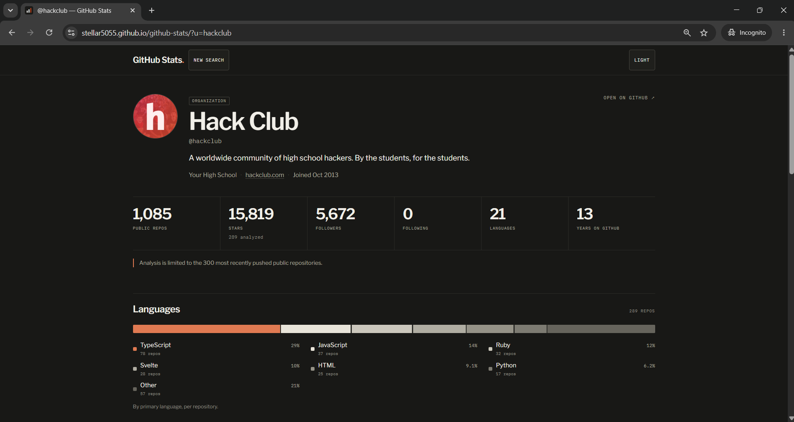
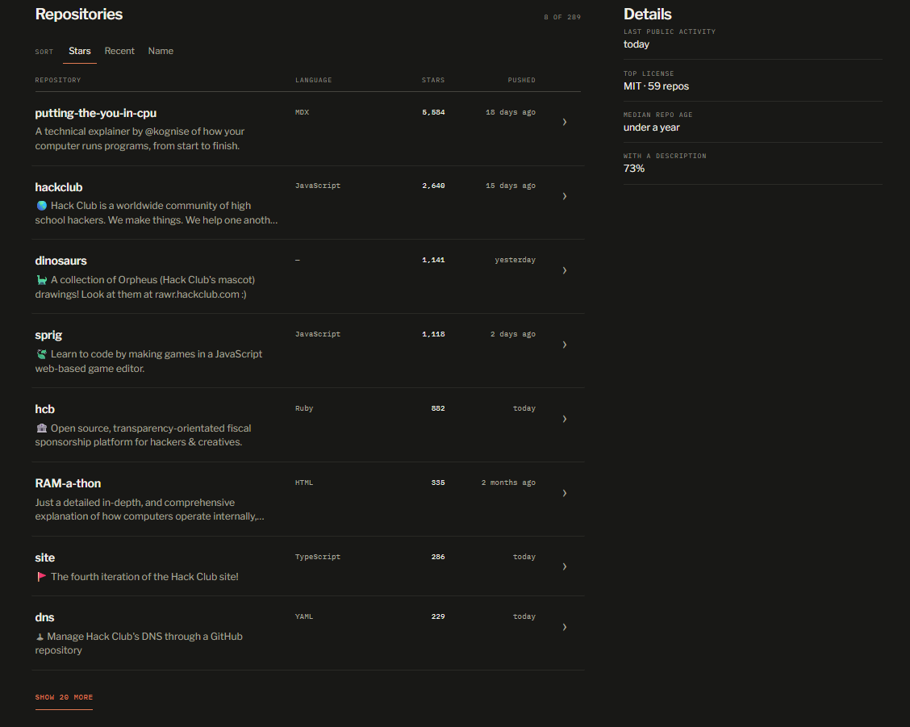
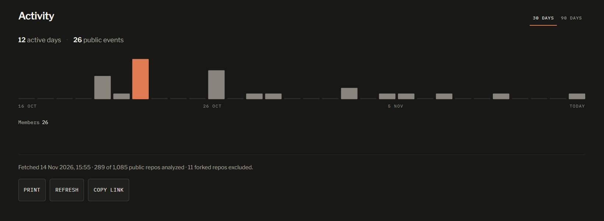

# GitHub Stats

**Get a quick insight on any public GitHub profile.**

[**TRY IT**](https://stellar5055.github.io/github-stats)

## What It Does

Search for a username or paste a profile URL or repository URL. You get the profile, the important numbers, languages, repositories and recent public activity on one page. Print a report or save it as a PDF. It has a dark mode and light mode

It uses public GitHub data from their API, and can read up to 300 repositories and 300 public events. The only issue with this is that GitHub's API allows only 60 requests per hour per IP. 

The [method page](https://stellar5055.github.io/github-stats/method.html) explains the counting rules if you want the exact details.

## How it’s built

Made in Vite and TypeScript. The landing page and method page are basic static HTML.

Profile data comes directly from the unauthenticated GitHub REST API, so no need for backend or database or any accounts.

Up to 300 public repositories and 300 public events are fetched - 3 pages of 100 each.

Successful lookups are cached in localStorage for 15 minutes to reduce getting rate limited by GitHub often by not scanning a profile again if accidentally refreshed.

There are dark and light themes which use an inline bootstrap to avoid a flash on loading. It follows the browser's theme preference by default whenever possible. Print always uses the light theme.

## More screenshots:

**Built for Hack Club Crossroads.**

## License
MIT.